# kinova-cam

Suporte de punho para a Intel RealSense **D435i** ou **D405** no **Kinova Gen3
6DOF (sem módulo de visão)** com a garra **Robotiq 2F-85**, modelado em B-rep com
[build123d](https://github.com/gumyr/build123d) (kernel OpenCascade).

O suporte é um anel bipartido que abraça o pescoço do módulo de interface; a
2F-85 continua montada direto no punho, com os pinos pogo ligados. Há quatro
versões da metade da câmera; a **metade de baixo é a mesma nas quatro**. Em
todas, a câmera fica de pé (furo de 1/4" voltado para o punho; garra na parte
de baixo da imagem).

| versão | peça | câmera | para quê |
|---|---|---|---|
| **original** (`ring`) | `ring_camera_half` | centrada no punho, 15°, rente ao Ø75 | visão geral, compacta |
| **RGB centrado** (`ring_rgb`) | `ring_rgb_camera_half` | D435i deslocada 32,5 mm para a lente RGB ficar no eixo da garra, 20°, 12 mm mais alta | garra no centro horizontal do RGB e profundidade do objeto entre os dedos |
| **estéreo centrado** (`ring_stereo`) | `ring_stereo_camera_half` | D435i com o meio da linha de base no eixo da garra, 20°, 12 mm mais alta | profundidade nas duas pontas dos dedos (o RGB fica 40 mm fora do eixo) |
| **D405** (`ring_d405`) | `ring_d405_camera_half` | D405 com o imageador esquerdo (cor e profundidade) no eixo da garra, 15° | o mesmo, com profundidade desde ~7–10 cm em resolução cheia |

<table>
<tr><td align="center"><br><sub>Anel no punho, lado da câmera</sub></td><td align="center"><br><sub>Lado dos parafusos M4</sub></td><td align="center"><br><sub>Lateral, com a 2F-85</sub></td></tr>
</table>

## Anel bipartido (versão original)

Duas metades que abraçam o pescoço do módulo de interface, entre os botões de
admitância e a junta 6. Esse trecho gira junto com a ferramenta, e a 2F-85
continua montada direto no punho, com os pinos pogo ligados.

- Furo com o perfil do pescoço (afina de Ø75 para Ø70, amostrado do STEP
  oficial em `WRIST_NECK`). O anel não escorrega em direção à garra.
- Ocupa de 21 a 49,5 mm atrás da face do bracelete: 1,7 mm atrás dos botões e
  1,5 mm antes da junta 6. Ø85 por fora.
- 2x M4 × 16 ISO 4762 (allen) nas orelhas em ±X, entrando pela metade de baixo
  e rosqueando em porcas M4 ISO 4032 embutidas na metade da câmera. Folga de
  1 mm entre as metades para o aperto. As orelhas ficam só na parte traseira,
  para não atrapalhar o dedo nos botões.
- A câmera fica no topo (+Y), de pé (furo de 1/4" voltado para o punho; a
  garra aparece na parte de baixo da imagem), encostada pela face traseira
  num apoio inclinado 15°, com 2x M3 × 10 por trás. A base do apoio se une ao anel em todo o
  comprimento (da face frontal à traseira) e em toda a largura, com filete de
  6 mm na junção. **Parafuse a câmera na metade de cima antes de
  montar o anel no robô**: depois, o acesso aos M3 fica apertado.
- Checagens no STEP do Gen3 6DOF: o anel só encosta no pescoço; câmera,
  parafusos e garra ficam livres. Girando a junta 6, o anel fica a 2,7 mm da
  carcaça da junta 5. Com a junta 6 em qualquer ângulo (passos de 30°), a
  junta 5 percorre ±120,3° sem colisão: no limite, anel e câmera ficam a
  40,9 mm do antebraço (o módulo sem anel fica a 41,5 mm). O contato só
  começaria entre 140° e 145°, além do limite da junta. Para refazer:
  `.venv/bin/python scripts/collision_sweep.py [ring|ring_rgb]`.
- Não aperte demais: a carcaça do módulo tem cerca de 2 mm de parede. Se
  quiser uma fita de borracha no furo, aumente `bore_clearance` em `params.py`.
- Ferragens: 2x M4 × 16 ISO 4762 + 2x porca M4 ISO 4032 (a ponta sai cerca
  de 2 mm além da orelha) e 2x M3 × 10 para a câmera.
- **Impressão e montagem:** ver [IMPRESSAO.md](IMPRESSAO.md). Os STL já saem
  na orientação de impressão (face traseira na mesa).

<table>
<tr><td align="center"><br><sub>Anel com a D435i</sub></td><td align="center"><br><sub>Traseira: apoio e furos M3</sub></td><td align="center"><br><sub>Vista explodida</sub></td></tr>
</table>

### Campo de visão

As montagens incluem os cones de visão da D435i (`FOV_D435i`): profundidade
87° × 58° (azul) a partir do imageador IR esquerdo, e RGB 69° × 42° (verde),
desenhados até 300 mm (`fov_range`). As posições das lentes seguem o URDF
oficial da Intel. Os dedos da 2F-85 ficam dentro dos dois campos, a cerca de
145–155 mm da câmera ao longo do eixo óptico. Isso fica abaixo da distância
mínima de profundidade da D435i em 1280 × 720 (cerca de 280 mm, pelo
datasheet). Para medir profundidade entre os dedos, use resolução menor
(424 × 240 chega a cerca de 105 mm) ou ajuste o *disparity shift*.

<table>
<tr><td align="center"><br><sub>Campo de visão (azul: profundidade; verde: RGB)</sub></td><td align="center"><br><sub>Campo de visão, lateral</sub></td><td align="center"><br><sub>Gen3 6DOF completo</sub></td></tr>
</table>

## Versão RGB centrado (`ring_rgb`)

Mesma metade de baixo, mesmas ferragens; muda só a metade da câmera
(`out/ring_rgb_camera_half.stl`, 111 cm³). Objetivos: a garra no centro
horizontal da imagem RGB e o objeto entre os dedos dentro da faixa de
profundidade da D435i.

- **Garra no centro horizontal do RGB.** A câmera é deslocada 32,5 mm ao longo
  da largura, até a lente RGB ficar no plano que contém o eixo da ferramenta.
  Com o eixo óptico sem guinada, esse plano projeta na coluna central da
  imagem (na vista simulada, o centro entre os dedos fica a 0 px do centro,
  contra 225 px na versão original, em que um dedo sai do quadro). O corpo da
  câmera passa por cima de uma das orelhas; ali o apoio vira uma placa que
  desce até 30 mm do eixo (`plate_r`).
- **Profundidade entre os dedos.** A câmera fica 12 mm mais alta (`gap` 15)
  e inclinada 20°. Com isso a palma da garra tapa menos o objeto: numa grade
  de pontos na região entre os dedos (z 105–145 mm da face do bracelete),
  94% são vistos pelos dois IR (90% na versão original) e 100% pelo RGB. O
  objeto fica a **Z = 115–156 mm** da câmera, ao longo do eixo óptico.
- **Configuração da RealSense:** profundidade em **424 × 240** (distância
  mínima ~105 mm). Em 480 × 270 o limite fica perto de 115 mm, no limite da
  faixa. O RGB pode continuar em resolução cheia. Tão perto, o erro de
  profundidade é submilimétrico. Alternativa: 848 × 480 com *disparity shift*
  (~50), que traz o mínimo para ~130 mm e o máximo para ~450 mm.
- **Câmera de pé**, como na versão original: furo de 1/4" voltado para o
  punho, garra na parte de baixo da imagem (a ~8° abaixo do centro).
- **Direção de aproximação:** o eixo da ferramenta continua no quadro do RGB,
  subindo pela coluna central, até ~2 m (18° acima do centro).
- **Colisão:** a j6 continua a 2,7 mm do Wrist2 (o limite é a face traseira
  do anel, que não mudou). Com a j5 em ±120,3°, a folga mínima até o
  antebraço é **28,2 mm** (40,9 mm na versão original); o contato só
  começaria além de ~133°.
- **Impressão:** costas do apoio a 45° (base do apoio mais larga na mesa,
  `tab_heel` 18). Ver [IMPRESSAO.md](IMPRESSAO.md).

Comparação (esquerda: original; direita: RGB centrado). A vista simulada é
gerada por `scripts/camera_view.py`; as demais, por
`scripts/render_images.sh ring_rgb` (em `out/images/ring_rgb/`).

<table>
<tr><td align="center">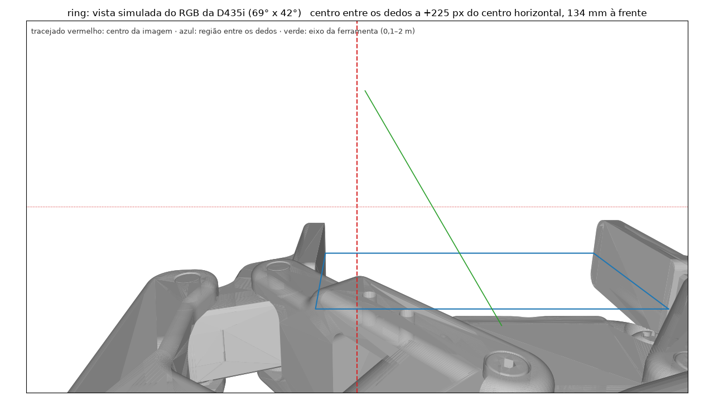<br><sub>original: vista simulada do RGB</sub></td><td align="center">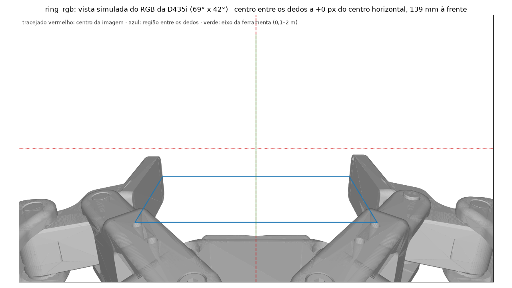<br><sub>RGB centrado: vista simulada do RGB</sub></td></tr>
<tr><td align="center"><br><sub>original: anel com a D435i</sub></td><td align="center">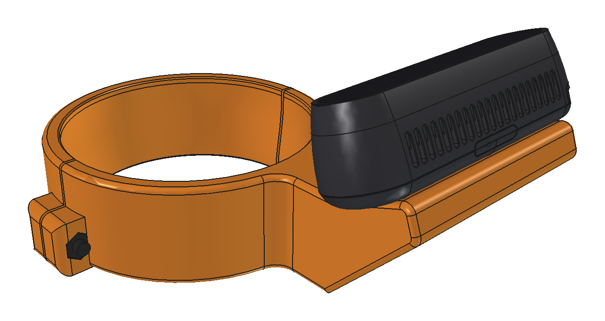<br><sub>RGB centrado: anel com a D435i</sub></td></tr>
<tr><td align="center"><br><sub>original: traseira</sub></td><td align="center">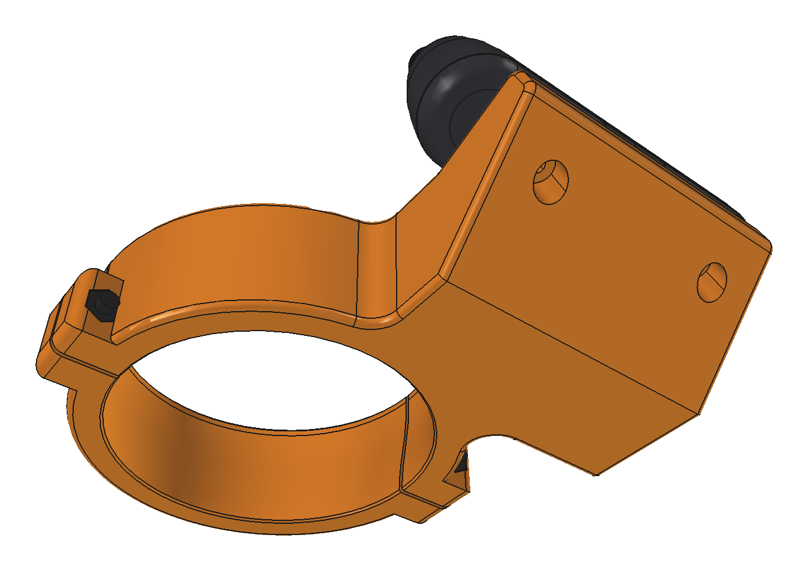<br><sub>RGB centrado: traseira</sub></td></tr>
<tr><td align="center"><br><sub>original: campo de visão, lateral</sub></td><td align="center">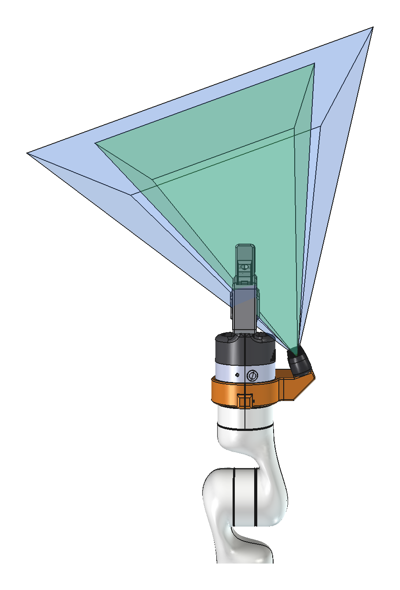<br><sub>RGB centrado: campo de visão, lateral</sub></td></tr>
<tr><td align="center"><br><sub>original: campo de visão</sub></td><td align="center">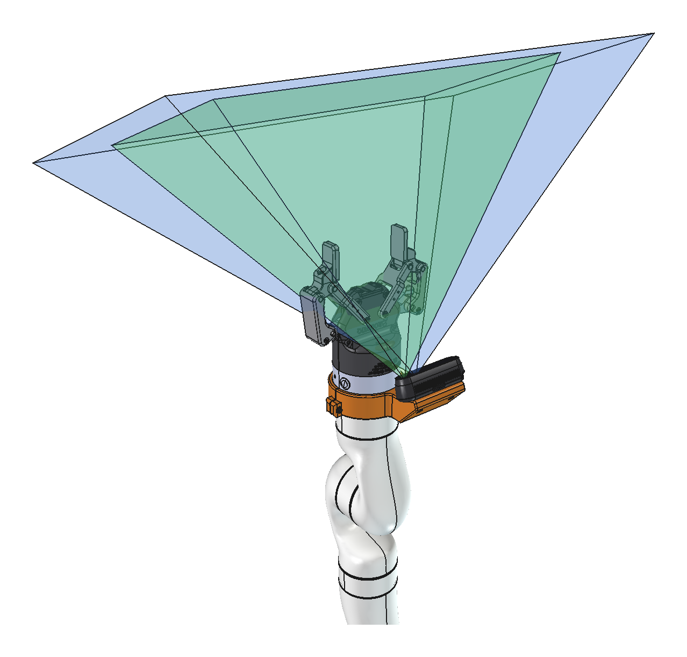<br><sub>RGB centrado: campo de visão</sub></td></tr>
<tr><td align="center"><br><sub>original: no punho</sub></td><td align="center">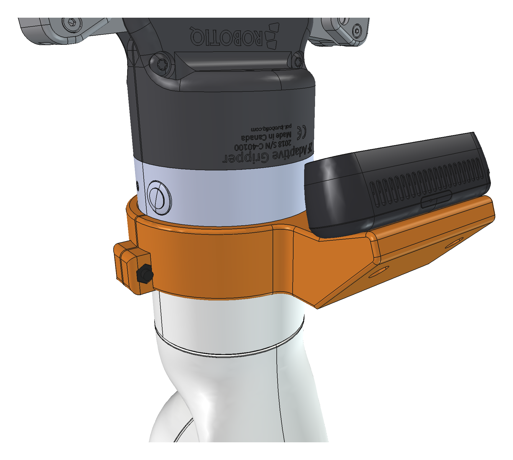<br><sub>RGB centrado: no punho</sub></td></tr>
</table>

## Versão estéreo centrado (`ring_stereo`)

Mesma altura e inclinação da RGB centrado, mas com o **meio da linha de base**
no plano do eixo da garra: os dois IR ficam entre os dedos (x = ±25 mm). Com o
RGB centrado, o IR direito fica em x = −65 mm, do lado de fora do dedo −X, e não
vê a face interna da ponta dele. Com a D435i não dá para ter as duas coisas.

- **Pontas com profundidade:** +X 91%, −X 97% (RGB centrado: 98% e 28%); dedo
  inteiro 33% e 51%.
- **Custo:** a garra fica 268 px fora do centro horizontal do RGB (em 1280),
  um pouco mais que na versão original (225 px), e, como nela, a ponta de um
  dos dedos sai parcialmente do quadro do RGB (69° de largura). Na imagem de
  profundidade (87°) os dois dedos aparecem inteiros.
- **Colisão:** j6 a 2,7 mm do Wrist2; com a j5 em ±120,3°, folga mínima de
  **32,8 mm**; contato só além de ~135°.
- **Peça:** 105 cm³, 100 × 87 × 36 mm, costas do apoio a 45°; a placa sobre a
  orelha é menor que na RGB centrado. Mesma metade de baixo, M3 × 10.

<table>
<tr><td align="center">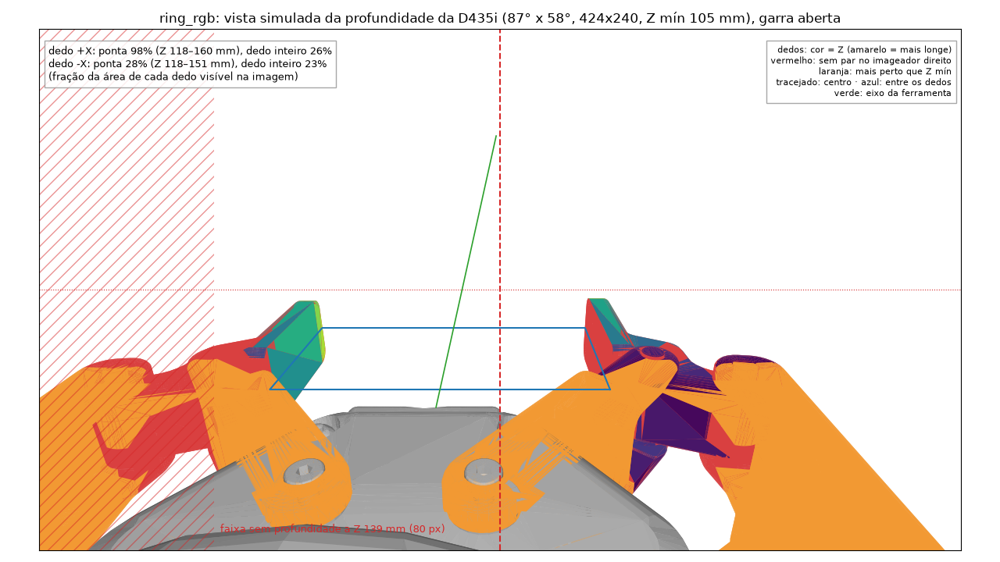<br><sub>RGB centrado: profundidade simulada</sub></td><td align="center">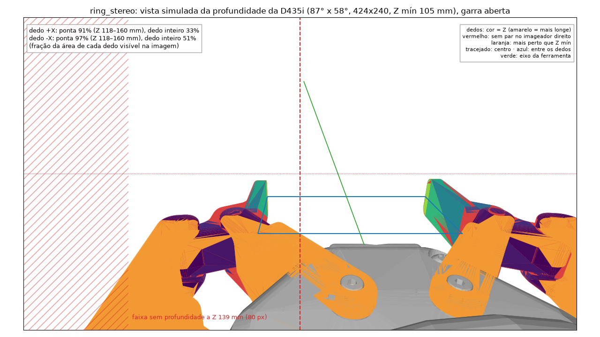<br><sub>estéreo centrado: profundidade simulada</sub></td></tr>
<tr><td align="center"><br><sub>RGB centrado: vista simulada do RGB</sub></td><td align="center">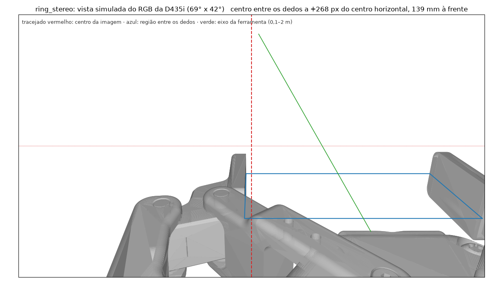<br><sub>estéreo centrado: vista simulada do RGB</sub></td></tr>
<tr><td align="center"><br><sub>RGB centrado: anel com a D435i</sub></td><td align="center">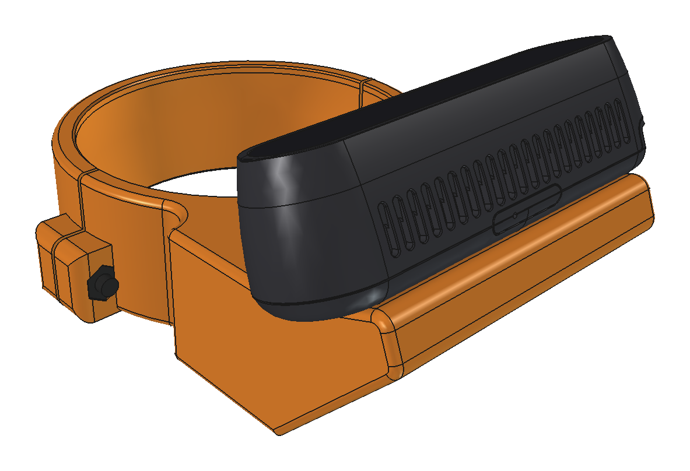<br><sub>estéreo centrado: anel com a D435i</sub></td></tr>
<tr><td align="center"><br><sub>RGB centrado: no punho</sub></td><td align="center">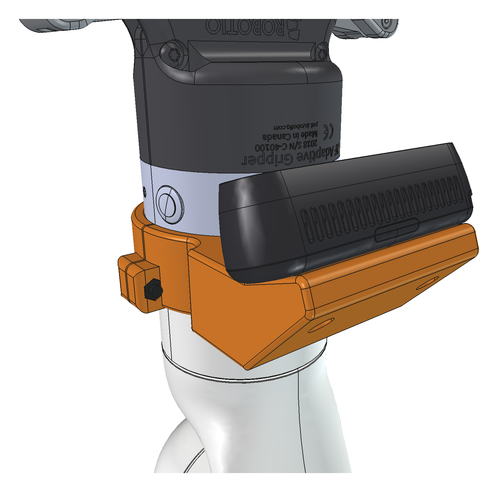<br><sub>estéreo centrado: no punho</sub></td></tr>
</table>

## Versão D405 (`ring_d405`)

A D405 (42 × 42 × 23 mm, 2x M3 traseiros a 20 mm, linha de base de 18 mm) é
feita para curta distância. A cor sai do próprio imageador esquerdo, já
alinhada com a profundidade, e a peça a põe no plano do eixo da garra
(deslocamento de 9 mm). Mesma metade de baixo e mesmos M4; os M3 da câmera
são **M3 × 12** (rosca de 5,5 mm).

- **Profundidade em resolução cheia:** o objeto entre os dedos fica a
  Z = 112–153 mm, acima do mínimo da D405 em 1280 × 720 (~100 mm). Não é
  preciso baixar a resolução nem mexer no *disparity shift*.
- **Visibilidade:** 98% da região entre os dedos é vista pelos dois
  imageadores; as pontas dos dois dedos têm profundidade em 97–100% da área
  visível (ver [Profundidade nos dedos](#profundidade-nos-dedos)).
- **Enquadramento:** garra 11° abaixo do centro da imagem, eixo de
  aproximação 13° acima; FOV de 87° × 58° também na cor.
- **Colisão:** j6 a 2,7 mm do Wrist2; com a j5 em ±120,3°, folga mínima de
  **35,4 mm** até o antebraço; contato só além de ~138°.
- **Peça:** 78 cm³, costas do apoio a 45,6° (`tab_heel` 18), apoio de 46 mm
  de largura, dentro do Ø do anel.

Comparação com a D435i RGB centrado (imagens em `out/images/ring_d405/`):

<table>
<tr><td align="center"><br><sub>D435i RGB centrado: vista simulada da cor</sub></td><td align="center">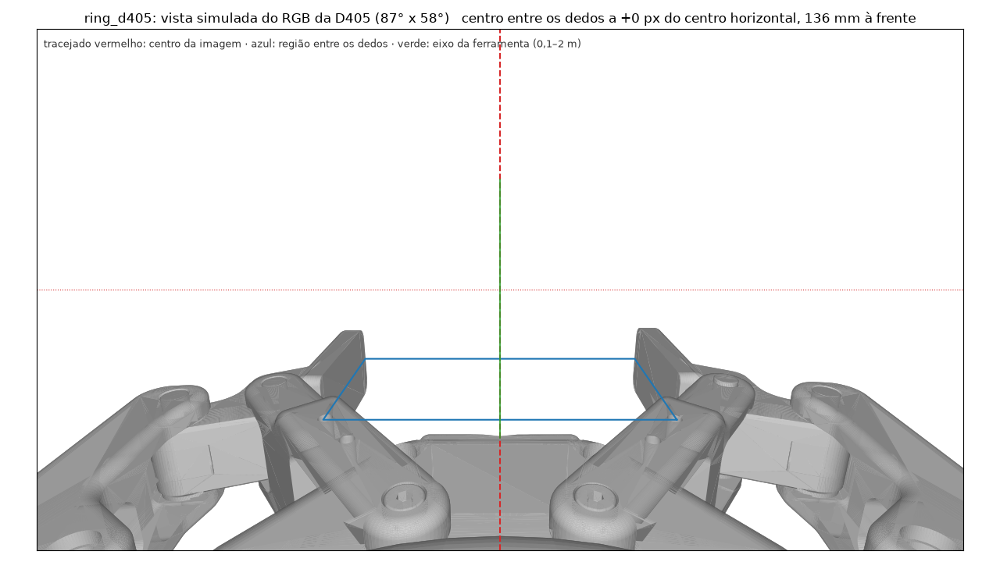<br><sub>D405: vista simulada da cor</sub></td></tr>
<tr><td align="center"><br><sub>D435i RGB centrado: anel com a câmera</sub></td><td align="center">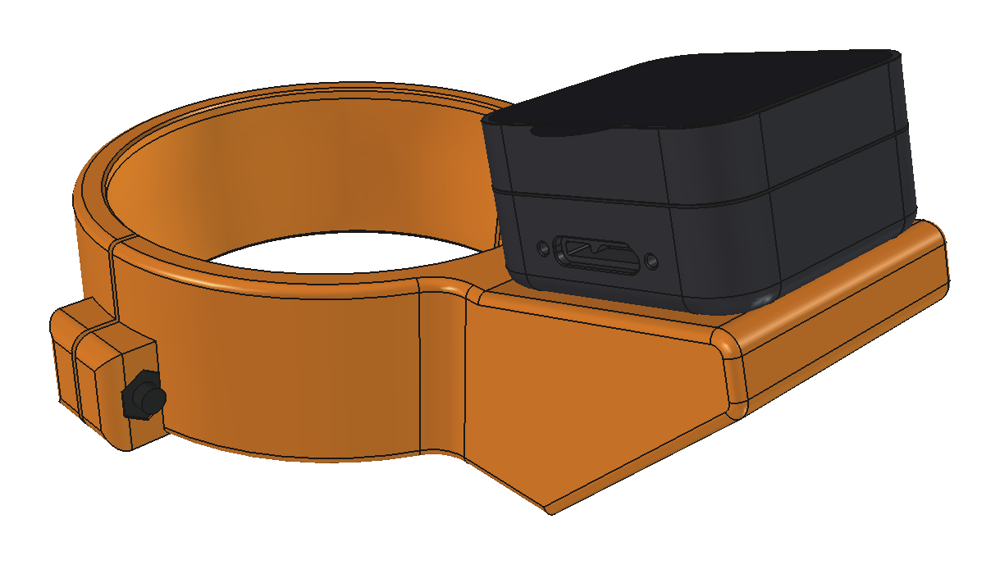<br><sub>D405: anel com a câmera</sub></td></tr>
<tr><td align="center"><br><sub>D435i RGB centrado: traseira</sub></td><td align="center">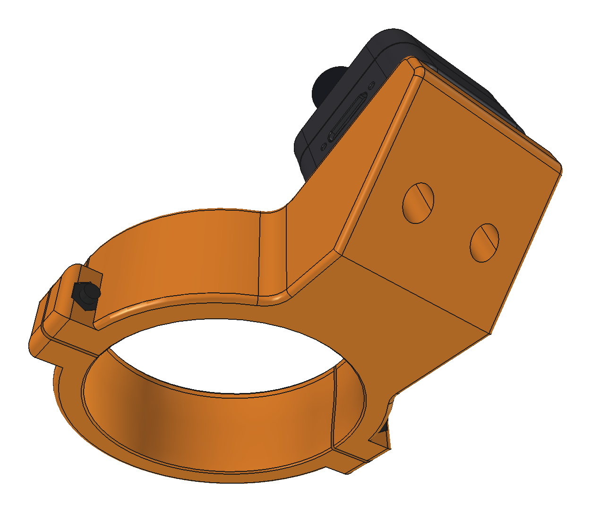<br><sub>D405: traseira</sub></td></tr>
<tr><td align="center"><br><sub>D435i RGB centrado: campo de visão, lateral</sub></td><td align="center">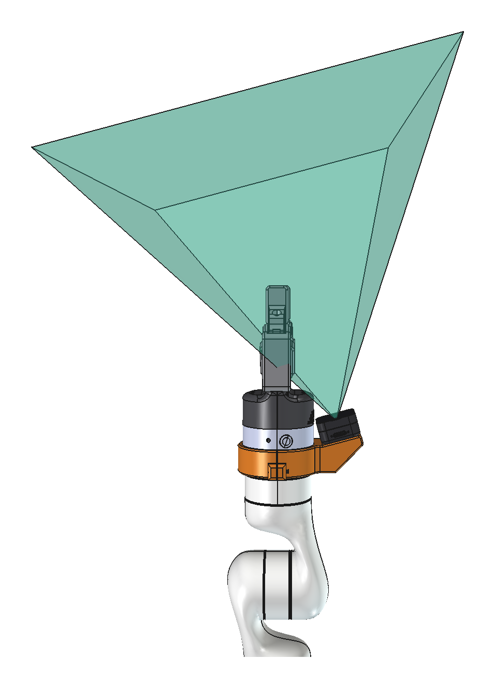<br><sub>D405: campo de visão, lateral</sub></td></tr>
<tr><td align="center"><br><sub>D435i RGB centrado: no punho</sub></td><td align="center">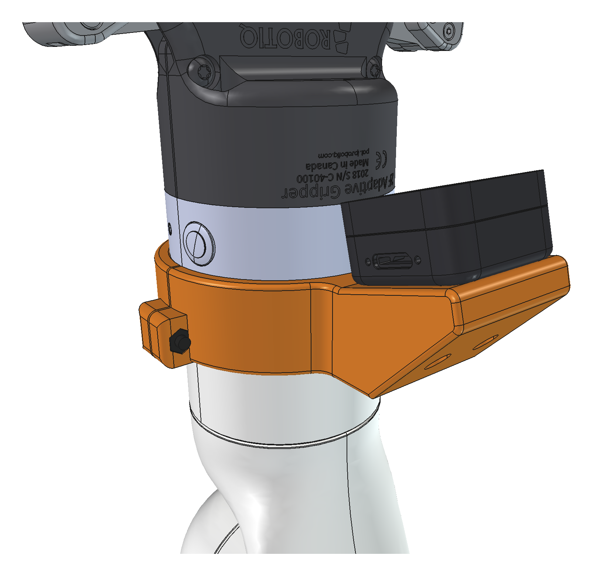<br><sub>D405: no punho</sub></td></tr>
</table>

## Profundidade nos dedos

`scripts/depth_view.py` simula a imagem de profundidade (imageador esquerdo)
com a garra totalmente aberta e colore os dedos: há profundidade onde o ponto
é visto pelos dois imageadores e está além da distância mínima. Pontas = as
almofadas dos dedos; dedo inteiro inclui as hastes, que ficam perto da palma.

| versão (resolução de profundidade) | ponta +X | ponta −X | Z das pontas | dedo inteiro |
|---|---|---|---|---|
| D435i original (424 × 240) | 94% | 63% | 114–155 mm | 19–28% |
| D435i RGB centrado (424 × 240) | 98% | **28%** | 118–160 mm | 23–26% |
| D435i estéreo centrado (424 × 240) | 91% | 97% | 118–160 mm | 33–51% |
| **D405** (1280 × 720) | **97%** | **100%** | 115–156 mm | 41–50% |

- As **hastes** perto da palma ficam mais perto que a distância mínima
  (laranja nas imagens) em todas as versões.
- Na **D435i RGB centrado**, o imageador direito fica sobre o dedo −X, do
  lado de fora dele, e não vê a face interna da ponta (a que encosta no
  objeto): sem par, sem profundidade. A face de cima da ponta é medida. A
  versão **estéreo centrado** resolve isso pondo os dois IR entre os dedos.
- A **faixa sem profundidade** da borda esquerda (fx·B/Z: ~80 px de 424 na
  D435i, ~89 px de 1280 na D405) não chega às pontas.

<table>
<tr><td align="center">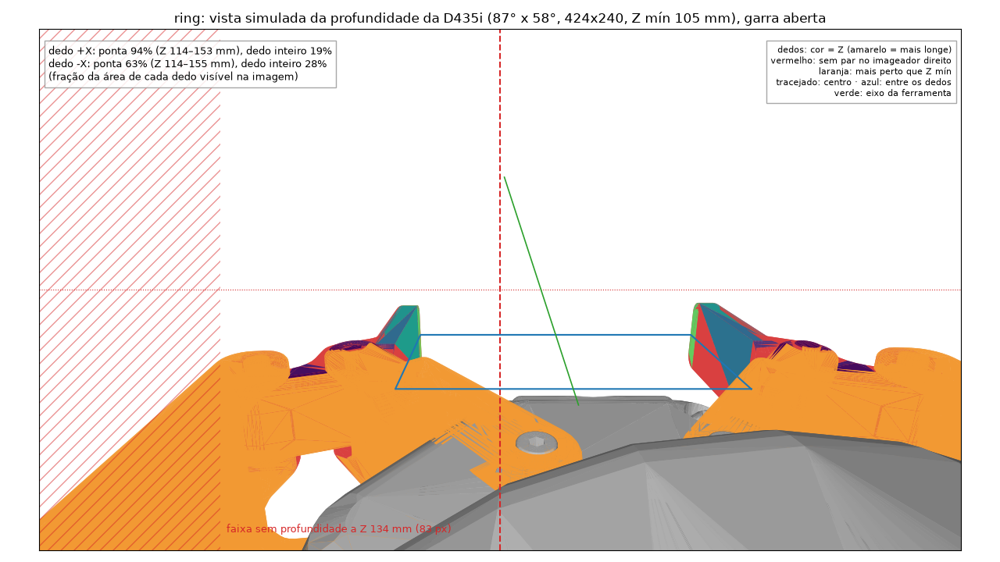<br><sub>D435i original</sub></td><td align="center"><br><sub>D435i RGB centrado</sub></td><td align="center">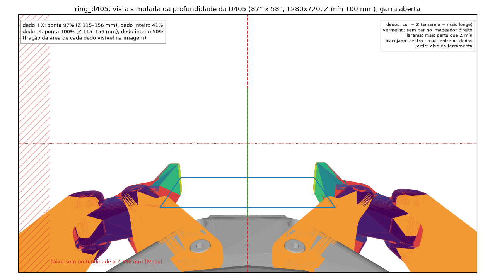<br><sub>D405</sub></td></tr>
</table>

Distância mínima de profundidade por resolução (Z_min ≈ fx·B/126; o valor
publicado pela Intel, quando há, fica 10–15% acima do teórico):

| resolução | fx (px) | D435i teórico | D435i publicado | D405 teórico | D405 publicado |
|---|---|---|---|---|---|
| 1280 × 720 | 645 | 256 mm | ~280 mm | 92 mm | ~100 mm |
| 848 × 480 | 427 | 170 mm | — | 61 mm | ~70 mm |
| 640 × 480 | 387 | 154 mm | — | 55 mm | — |
| 640 × 360 | 323 | 128 mm | — | 46 mm | — |
| 480 × 270 | 242 | 96 mm | — | 35 mm | — |
| 424 × 240 | 214 | 85 mm | ~105 mm | 31 mm | — |

Com *disparity shift* (DS): Z_min = fx·B/(126+DS) e Z_max = fx·B/DS.

## ROS

O pacote ROS 2 **`ros/kinova_cam_description`** é gerado do modelo por
`scripts/ros_export.py` e traz, para cada versão: a transformação
`end_effector_link → camera_link` (`config/camera_mounts.yaml`), um launch de TF
estático, macros xacro da montagem (com as malhas do anel, também como colisão
para o MoveIt; a malha da câmera é opcional e, por ser CAD da Intel, não é
versionada) e URDFs isolados para conferência. Uso e detalhes
no [README do pacote](ros/kinova_cam_description/README.md).

O `end_effector_link` do `ros2_kortex` fica no eixo da junta 6, **2,87 mm atrás
da face do aro Ø75** (fundo do rebaixo Ø71), com Z saindo da ferramenta e +Y no
lado do módulo de visão da Kinova. Sem o módulo, a referência física são os
botões de admitância: ficam em ±X, deslocados ~10 mm para −Y. Monte a câmera do
lado oposto a esse deslocamento (+Y), de pé, com as orelhas alinhadas com os
botões.

Transformação `end_effector_link → camera_link` (`camera_link` = imageador
esquerdo, no plano de profundidade zero, como no realsense-ros); valores do
CAD, sem calibração:

| versão | xyz (m) | rpy (rad) |
|---|---|---|
| original | 0.0175 0.05366 0.0052 | 0 -1.30900 -1.57080 |
| RGB centrado | -0.0150 0.06568 0.00569 | 0 -1.22173 -1.57080 |
| estéreo centrado | 0.0250 0.06568 0.00569 | 0 -1.22173 -1.57080 |
| D405 | 0.0000 0.06177 0.00585 | 0 -1.30900 -1.57080 |

```bash
ros2 launch kinova_cam_description static_tf.launch.py version:=ring_stereo
```

```xml
<!-- no xacro do robô, depois do braço do ros2_kortex -->
<xacro:include filename="$(find kinova_cam_description)/urdf/kinova_cam_mount.urdf.xacro"/>
<xacro:kinova_cam_mount parent="end_effector_link" version="ring_stereo"/>
```

O driver da RealSense publica o resto da árvore (`camera_depth_optical_frame`,
`camera_color_optical_frame` etc.) com a calibração de fábrica. A profundidade
alinhada e a nuvem com `align_depth` saem no `camera_color_optical_frame`. Para
ter a câmera inteira no URDF, use `kinova_cam_mount_realsense` (xacro oficial
da `realsense2_description`) e o driver com `publish_tf:=false`.

Os xacros foram expandidos (xacro 2.1, com os xacros oficiais da RealSense) e
conferidos: as quatro versões, nas três formas, dão a mesma transformação do
YAML.

## Uso

```bash
python3 -m venv .venv && .venv/bin/pip install -r requirements.txt
scripts/fetch_vendor.sh               # CAD oficiais -> vendor/ (ver "CAD da D435i")
.venv/bin/python build.py --full      # as quatro versões (--variant ring|ring_rgb|ring_stereo|ring_d405)
scripts/make_fcstd.sh                 # projeto FreeCAD do anel original, já aberto
scripts/make_fcstd.sh ring_rgb        # idem, versão RGB centrado
scripts/render_images.sh              # imagens do original -> out/images/
scripts/render_images.sh ring_rgb     # imagens do RGB centrado -> out/images/ring_rgb/
scripts/render_images.sh ring_stereo  # imagens do estéreo centrado -> out/images/ring_stereo/
scripts/render_images.sh ring_d405    # imagens da D405 -> out/images/ring_d405/
.venv/bin/python scripts/camera_view.py   # vista simulada do RGB (10_vista_rgb.png)
.venv/bin/python scripts/depth_view.py    # vista simulada da profundidade (11_vista_profundidade.png)
.venv/bin/python scripts/ros_export.py    # pacote ROS 2 em ros/kinova_cam_description
```

`render_images.sh` roda o FreeCAD numa tela virtual (Xvfb), sem abrir janela.

Saídas em `out/`:

| arquivo | conteúdo |
|---|---|
| `ring_camera_half.step` / `.stl` | metade da câmera, versão original |
| `ring_rgb_camera_half.step` / `.stl` | metade da câmera, versão RGB centrado |
| `ring_stereo_camera_half.step` / `.stl` | metade da câmera, versão estéreo centrado |
| `ring_d405_camera_half.step` / `.stl` | metade da câmera, versão D405 |
| `ring_lower_half.step` / `.stl` | metade de baixo (a mesma nas quatro versões) |
| `wrist_<versão>_exploded.step` | vista explodida do anel |
| `wrist_<versão>_assembly.step` | anel + parafusos + câmera + garra |
| `kinova_gen3_d435i_<versão>.step` / `.FCStd` | Gen3 6DOF + anel + câmera + garra |
| `images/*.png`, `images/<versão>/*.png` | imagens (`render_images.sh`, `camera_view.py`, `depth_view.py`) |
| `d435i.step`, `d405.step` | câmeras (CAD oficial, se presente em `vendor/`) |

Todos os parâmetros estão em `src/kinova_cam/params.py`.

## FreeCAD

O FreeCAD do snap só lê arquivos dentro do `$HOME`, e não consegue abrir nada
em `/dados`. Por isso `scripts/make_fcstd.sh` trabalha em
`~/snap/freecad/common/kinova-cam/` e copia o `.FCStd` de volta para `out/`.
Para reabrir o projeto, use a cópia de `~/snap/freecad/common/kinova-cam/`.

O projeto é gerado pela interface gráfica (no `freecad.cmd` as cores se
perdem), com o braço semitransparente e a vista enquadrada no punho.

## Visualização no VS Code

Usa a extensão **OCP CAD Viewer** (`bernhard-42.ocp-cad-viewer`) com o pacote
`ocp_vscode` da venv (as versões das duas precisam bater). O workspace já
aponta o interpretador para `.venv` em `.vscode/settings.json`.

1. Abra a pasta `kinova-cam` no VS Code (`code /dados/sandbox/kinova-cam`).
2. Abra o viewer pelo ícone OCP da barra lateral ou com `Ctrl+K V` num `.py`.
3. Rode `view.py` (▶ ou `.venv/bin/python view.py`). Com `--variant ring_rgb`,
   mostra a versão RGB centrado; com `--arm`, também o punho do Gen3 em
   transparência.

Ao editar `params.py`, rode `view.py` de novo; a câmera do viewer é mantida.

## CAD das câmeras

A RealSense só publica o CAD em SolidWorks (`D435i_Solid.SLDPRT` e
`D405_Solid.SLDPRT`, baixados por `scripts/fetch_vendor.sh`). Os STEP
convertidos **já estão versionados em `vendor/`** (o resto de `vendor/` é
baixado pelo script). Para converter de novo, use o Onshape: importe o
`.SLDPRT`, use **Translate…** se a aba vier só como arquivo e
**Export → STEP (mm)**. Os nomes são os que o Onshape gera:

- `D435i_Solid - D435i Solid.step` (corpo) e `D435i_Solid - D435i cvr.step`
  (vidro frontal, opcional)
- `D405_Solid.step` (corpo e vidro no mesmo arquivo)

Sem esses arquivos, o projeto usa um envelope do datasheet. Os 2x M3 dos CAD
oficiais coincidem com os furos do suporte. O CAD não traz as lentes: as
posições dos imageadores vêm do URDF oficial (realsense-ros), conferidas pelo
lado do USB-C (D435i: direita da câmera; D405: esquerda).

## Pontos a verificar

- **Orientação no punho:** o anel gira livre no pescoço até ser apertado; a
  posição da câmera se define na montagem (ver [ROS](#ros)). O sentido de +X
  do `end_effector_link` sai da regra da mão direita: o STEP simplificado do
  Gen3 não traz o furo do pino-guia. Confira no RViz girando a junta 6.
- **Garra no centro do RGB:** girar o anel em volta do punho não tira a garra
  do centro (o eixo da ferramenta continua na coluna central; os dedos só
  giram na imagem). O que a desloca é guinada da câmera no apoio, por folga
  nos M3: cerca de 16 px por grau, a 1280 px. Aperte os M3 com a câmera
  encostada.
- **Garra:** a análise de visibilidade usa a 2F-85 (abertura de 85 mm, pontas
  a ~146 mm da face). Com a 2F-140 os dedos são bem mais longos.
- **Material:** impressão 3D em **PLA** (escolha do usuário): reaperte os M4
  depois das primeiras horas e observe o calor do punho; PETG/ASA se o anel
  ceder (ver [IMPRESSAO.md](IMPRESSAO.md)).
  Atualize a massa e o CoM da ferramenta na Web App (`SetToolConfiguration`),
  somando o anel, a câmera e o cabo USB.
