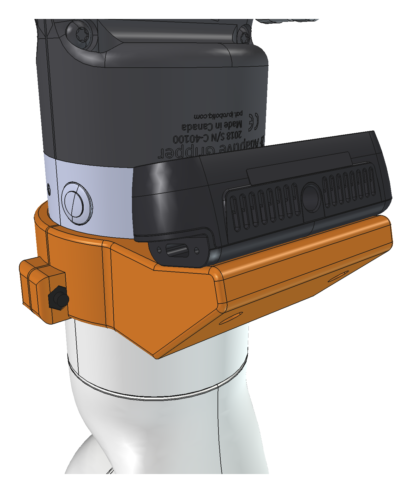
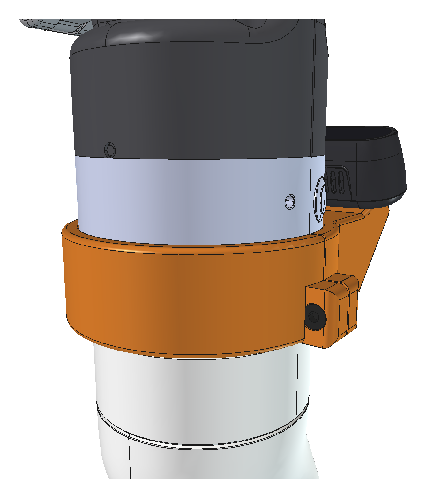
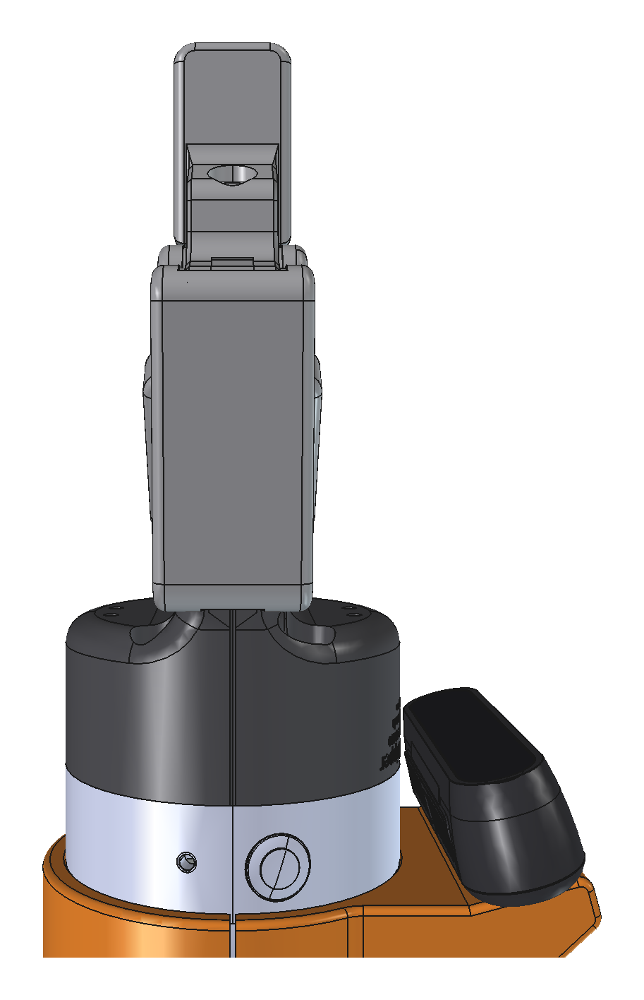
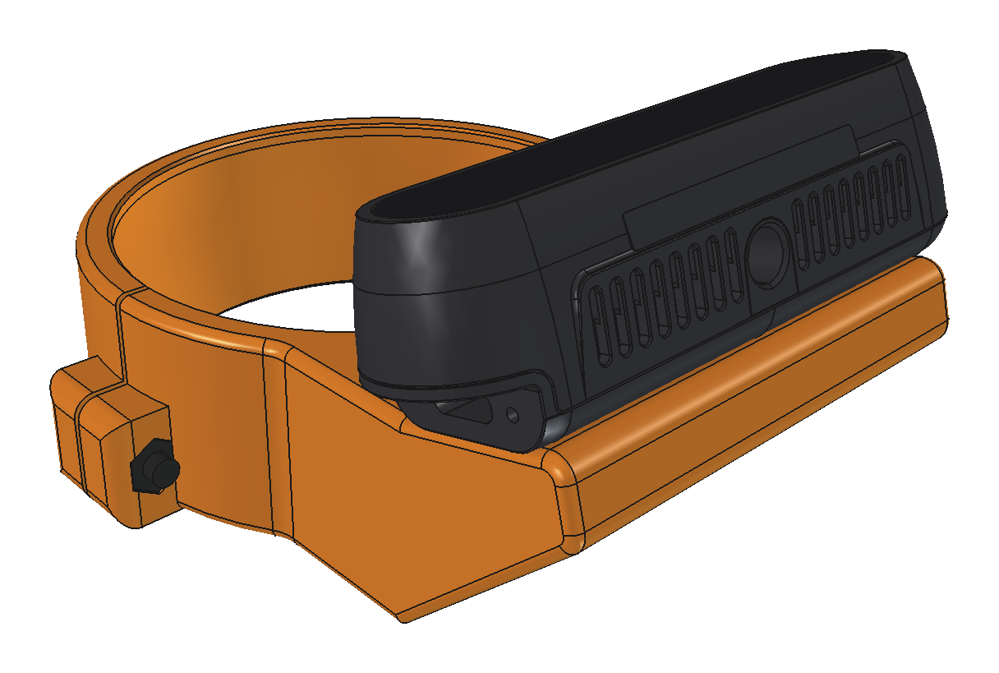
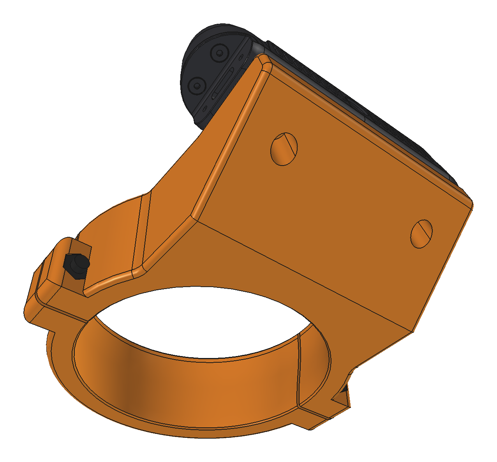
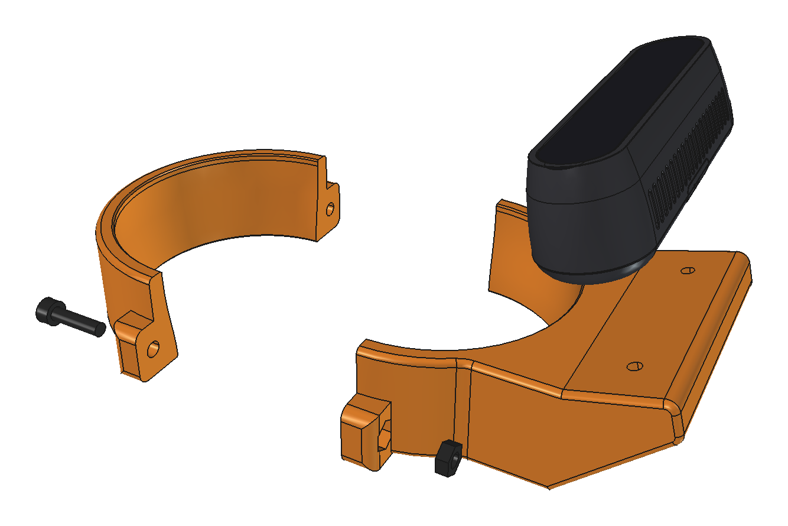
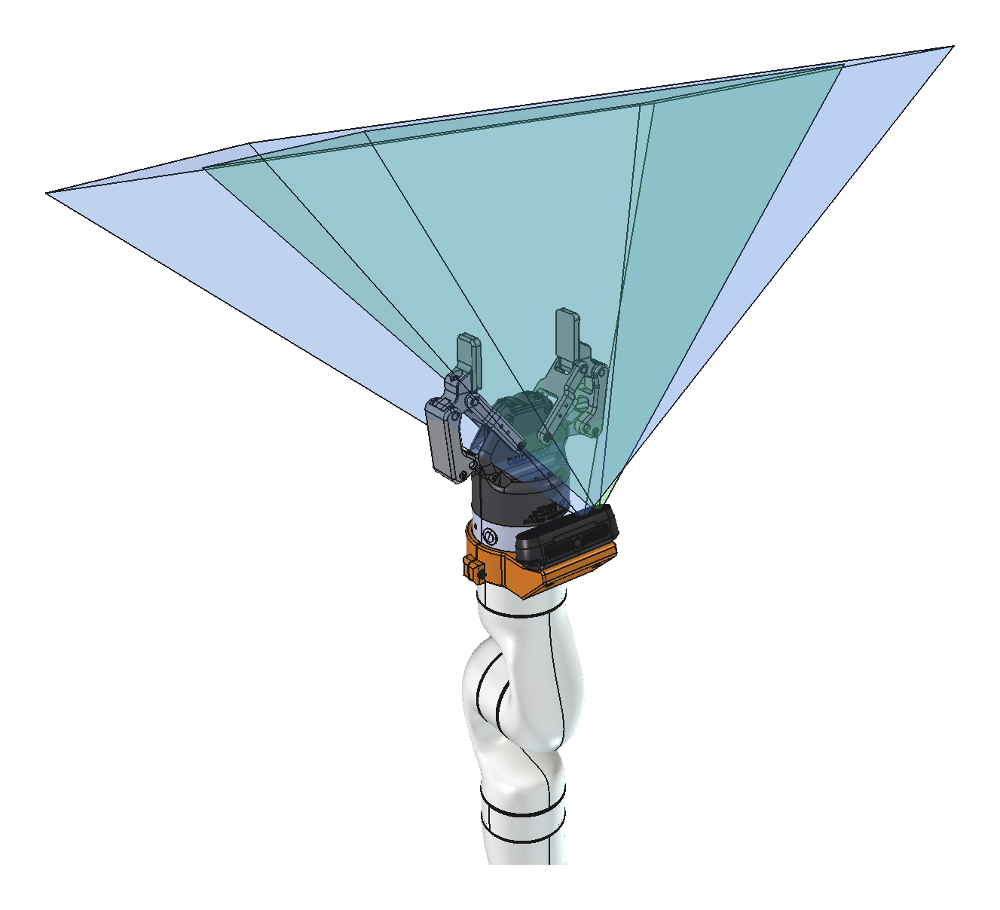
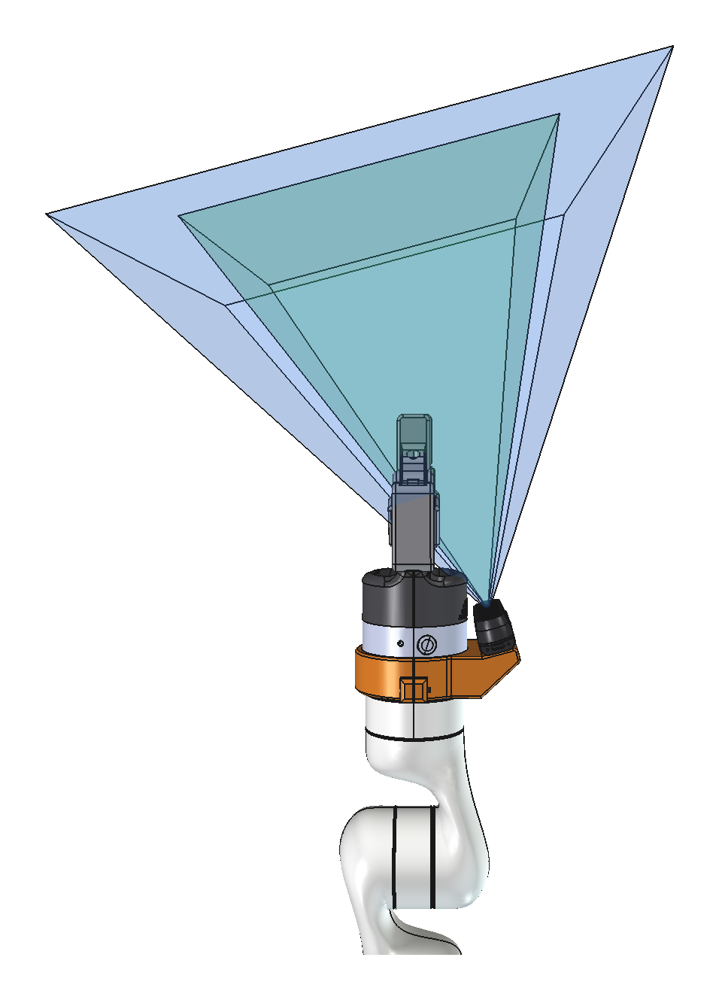
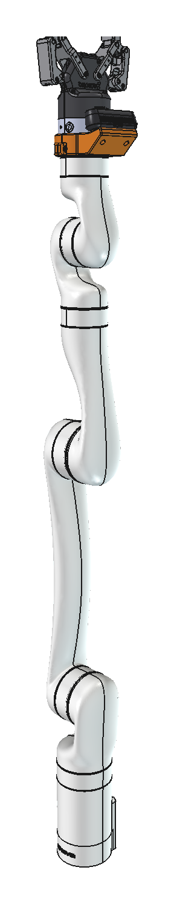

# kinova-cam

Suporte de punho para a Intel RealSense **D435i** no **Kinova Gen3 6DOF (sem
módulo de visão)** com a garra **Robotiq 2F-85**, modelado em B-rep com
[build123d](https://github.com/gumyr/build123d) (kernel OpenCascade).

Há duas versões:

| versão | módulo | garra | ligação elétrica da garra |
|---|---|---|---|
| **anel bipartido** | `clamp_ring.py` | direto no punho | normal (pinos pogo) |
| espaçador | `adapter.py` | sobre o espaçador (+12 mm) | **interrompida** (ver abaixo) |

<table>
<tr><td align="center"><br><sub>Anel no punho, lado da câmera</sub></td><td align="center"><br><sub>Lado dos parafusos M4</sub></td><td align="center"><br><sub>Lateral, com a 2F-85</sub></td></tr>
</table>

## Versão anel bipartido

Duas metades que abraçam o pescoço do módulo de interface, entre os botões de
admitância e a junta 6. Esse trecho gira junto com a ferramenta, e a 2F-85
continua montada direto no punho, com os pinos pogo ligados.

- Furo com o perfil do pescoço (afina de Ø75 para Ø70, amostrado do STEP
  oficial em `WRIST_NECK`). O anel não escorrega em direção à garra.
- Ocupa de 21 a 49,5 mm atrás da face do bracelete: 1,7 mm atrás dos botões e
  1,5 mm antes da junta 6. Ø85 por fora.
- 2x M4 × 16 ISO 4762 (allen) nas orelhas em ±X, entrando pela metade de baixo
  e rosqueando em porcas M4 ISO 4032 embutidas na metade da câmera. Folga de
  1 mm entre as metades para o aperto. As orelhas ficam só na parte traseira,
  para não atrapalhar o dedo nos botões.
- A câmera fica no topo (+Y), encostada pela face traseira num apoio inclinado
  15°, com 2x M3 × 8 por trás. A base do apoio se une ao anel em todo o
  comprimento (da face frontal à traseira) e em toda a largura, com filete de
  6 mm na junção. **Parafuse a câmera na metade de cima antes de
  montar o anel no robô**: depois, o acesso aos M3 fica apertado.
- Checagens no STEP do Gen3 6DOF: o anel só encosta no pescoço; câmera,
  parafusos e garra ficam livres. Girando a junta 6, o anel fica a 2,7 mm da
  carcaça da junta 5. Com a junta 6 em qualquer ângulo (passos de 30°), a
  junta 5 percorre ±120,3° sem colisão: no limite, anel e câmera ficam a
  40,6 mm do antebraço (o módulo sem anel fica a 41,5 mm). O contato só
  começaria entre 140° e 145°, além do limite da junta. Para refazer:
  `.venv/bin/python scripts/collision_sweep.py`.
- Não aperte demais: a carcaça do módulo tem cerca de 2 mm de parede. Se
  quiser uma fita de borracha no furo, aumente `bore_clearance` em `params.py`.
- Ferragens: 2x M4 × 16 ISO 4762 + 2x porca M4 ISO 4032 (a ponta sai cerca
  de 2 mm além da orelha) e 2x M3 × 8 para a câmera.
- **Impressão e montagem:** ver [IMPRESSAO.md](IMPRESSAO.md). Os STL já saem
  na orientação de impressão (face traseira na mesa).

<table>
<tr><td align="center"><br><sub>Anel com a D435i</sub></td><td align="center"><br><sub>Traseira: apoio e furos M3</sub></td><td align="center"><br><sub>Vista explodida</sub></td></tr>
</table>

### Campo de visão

As montagens incluem os cones de visão da D435i (`FOV_D435i`): profundidade
87° × 58° (azul) a partir do imageador IR esquerdo, e RGB 69° × 42° (verde),
desenhados até 300 mm (`fov_range`). As posições das lentes seguem o URDF
oficial da Intel. Os dedos da 2F-85 ficam dentro dos dois campos, a cerca de
145–155 mm da câmera ao longo do eixo óptico. Isso fica abaixo da distância
mínima de profundidade da D435i em 1280 × 720 (cerca de 280 mm, pelo
datasheet). Para medir profundidade entre os dedos, use resolução menor
(424 × 240 chega a cerca de 105 mm) ou ajuste o *disparity shift*.

<table>
<tr><td align="center"><br><sub>Campo de visão (azul: profundidade; verde: RGB)</sub></td><td align="center"><br><sub>Campo de visão, lateral</sub></td><td align="center"><br><sub>Gen3 6DOF completo</sub></td></tr>
</table>

## Versão espaçador

A base da 2F-85 tem a mesma interface do punho do Gen3 (Figura 38 do
*Gen3 User Guide R07*): ressalto Ø71, 4x M5 em 54 × 32, pino Ø4 em (30,5; 0) e
contatos pogo. O espaçador replica essa interface dos dois lados:

- Embaixo: piloto Ø71 h8 (2,8 mm) que entra no bracelete.
- Em cima: alojamento Ø71 (3,3 mm) para o ressalto da garra.
- 4x Ø5,3 passantes: os M5 da garra atravessam o espaçador e rosqueiam no punho.
- Pino Ø4 passante e janela passante para os pogo.
- Aba no topo do punho (+Y; ajustável por `cam_side_deg`) com apoio inclinado
  (`cam_tilt_deg`, padrão 15°) e 2x M3 escareados por baixo para a câmera.
- Bordas arredondadas (2 mm). A borda da face da garra tem chanfro de 0,5 mm,
  para o perfil continuar rente à base Ø75 da 2F-85.

A faixa Ø75 do bracelete tem só 23 mm, e os botões de admitância ocupam 14 mm
dela; por isso o anel fica atrás dela, no pescoço.

**Ligação elétrica:** a 2F-85 recebe 24 V e RS-485 por 10 pinos de mola do
punho, que encostam numa placa de contatos dentro da base da garra. O
espaçador afasta essa placa 12 mm, e a garra fica sem energia e sem comando.
O RS-485 só existe nesse conector (a porta de expansão de 20 vias não tem), então
seria preciso uma placa de passagem com pinos pogo dentro da janela de 24 × 11 mm.

## Uso

```bash
python3 -m venv .venv && .venv/bin/pip install -r requirements.txt
scripts/fetch_vendor.sh               # CAD oficiais -> vendor/ (ver "CAD da D435i")
.venv/bin/python build.py --full      # as duas versões (--variant ring|spacer)
scripts/make_fcstd.sh ring            # projeto FreeCAD do anel, já aberto
scripts/make_fcstd.sh                 # projeto FreeCAD do espaçador
scripts/render_images.sh              # imagens da versão anel -> out/images/
```

`render_images.sh` roda o FreeCAD numa tela virtual (Xvfb), sem abrir janela.

Saídas em `out/`:

| arquivo | conteúdo |
|---|---|
| `ring_camera_half.step` / `.stl` | anel: metade da câmera |
| `ring_lower_half.step` / `.stl` | anel: metade de baixo |
| `wrist_ring_exploded.step` | vista explodida do anel |
| `images/*.png` | imagens da versão anel (`render_images.sh`) |
| `wrist_ring_assembly.step` | anel + parafusos + câmera + garra |
| `kinova_gen3_d435i_ring.step` / `.FCStd` | Gen3 6DOF + anel + câmera + garra |
| `adapter.step` / `adapter.stl` | espaçador (STL para impressão) |
| `wrist_assembly.step` | espaçador + câmera + garra |
| `kinova_gen3_d435i.step` / `.FCStd` | Gen3 6DOF + espaçador + câmera + garra |
| `d435i.step` | D435i (CAD oficial, se presente em `vendor/`) |

Todos os parâmetros estão em `src/kinova_cam/params.py`.

## FreeCAD

O FreeCAD do snap só lê arquivos dentro do `$HOME`, e não consegue abrir nada
em `/dados`. Por isso `scripts/make_fcstd.sh` trabalha em
`~/snap/freecad/common/kinova-cam/` e copia o `.FCStd` de volta para `out/`.
Para reabrir o projeto, use a cópia de `~/snap/freecad/common/kinova-cam/`.

O projeto é gerado pela interface gráfica (no `freecad.cmd` as cores se
perdem), com o braço semitransparente e a vista enquadrada no punho.

## Visualização no VS Code

Usa a extensão **OCP CAD Viewer** (`bernhard-42.ocp-cad-viewer`) com o pacote
`ocp_vscode` da venv (as versões das duas precisam bater). O workspace já
aponta o interpretador para `.venv` em `.vscode/settings.json`.

1. Abra a pasta `kinova-cam` no VS Code (`code /dados/sandbox/kinova-cam`).
2. Abra o viewer pelo ícone OCP da barra lateral ou com `Ctrl+K V` num `.py`.
3. Rode `view.py` (▶ ou `.venv/bin/python view.py`). Com `--ring`, mostra a
   versão anel; com `--arm`, também o punho do Gen3 em transparência.

Ao editar `params.py`, rode `view.py` de novo; a câmera do viewer é mantida.

## CAD da D435i

A RealSense só publica o CAD em SolidWorks (`D435i_Solid.SLDPRT`, baixado por
`scripts/fetch_vendor.sh`). Para usá-lo, converta para STEP no Onshape:
importe o `.SLDPRT`, use **Translate…** se a aba vier só como arquivo e
**Export → STEP (mm)**. Salve em `vendor/` com os nomes que o Onshape gera:

- `D435i_Solid - D435i Solid.step` (corpo)
- `D435i_Solid - D435i cvr.step` (vidro frontal, opcional)

Sem esses arquivos, o projeto usa um envelope do datasheet (90 × 25 × 25, M3 a
45 mm). Os 2x M3 do CAD oficial coincidem com os furos do suporte.

## Ferragens (espaçador)

- 4x M5 SHCS da garra, **12 mm mais longos** que os usados para montar a 2F-85
  direto no punho (o espaçador tem 12 mm entre os assentos). Use o O-ring
  original em volta do piloto.
- 1x pino Ø4 × 10 prensado por baixo, com 4 mm salientes para o furo do punho.
  O pino da própria garra entra por cima no mesmo furo; sobram cerca de 2 mm
  entre os dois.
- 2x M3 × 8 para a câmera (5 mm de material + 3 mm na rosca da D435i, que
  tem 3,5 mm de profundidade).

## Pontos a verificar

- **Pogo (espaçador):** ver "Ligação elétrica" acima. O anel não tem esse problema.
- **Orientação do pino-guia:** o STEP simplificado do Gen3 não traz os furos
  da interface. Assumi o pino em +X e o topo do punho em +Y. Se for diferente,
  ajuste `cam_side_deg`.
- **Material:** em impressão 3D (ver [IMPRESSAO.md](IMPRESSAO.md)), avalie a carga (o guia da Kinova recomenda
  alumínio quando há carga útil). Os M5 apertam a garra através da peça, então
  ela trabalha em compressão. Atualize a massa e o CoM da ferramenta na Web App
  (`SetToolConfiguration`).
